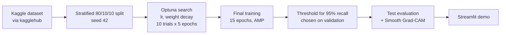

# Sickle Cell Detection: Swin Transformer vs ResNet50

Binary classification of blood-smear microscopy images with explainability (Grad-CAM) and a Streamlit demo. The project compares a Vision Transformer (Swin-Base) against a CNN baseline (ResNet50) and tunes the decision threshold toward high recall, since a missed positive is the costly error.

> Research demo. Not a medical device and not for diagnosis.

## Results

Threshold selected on the **validation split** to target 95% recall; test set (57 images, 10% stratified hold-out, seed 42) used only for final evaluation. Results written to `results/metrics_<model>.json`.

| Model | Test accuracy | Positive-class F1 | ROC-AUC | Threshold (val) |
|---|:---:|:---:|:---:|:---:|
| Swin-Base (`swin_base_patch4_window7_224`) | 91.2% | 0.9425 | 0.921 | 0.227 |
| ResNet50 | 91.2% | 0.9383 | 0.971 | 0.359 |

The test split is small (57 images), so a gap of a few images is within noise: treat the two models as comparable rather than ranked. ResNet50 achieves a higher ROC-AUC (0.971 vs 0.921) while Swin-Base reaches higher recall at the chosen threshold (97.6% vs 90.5%). `main.py` selects the threshold on the validation split and writes `results/metrics_<model>.json` (accuracy, precision, recall, F1, ROC-AUC, confusion matrix at the validation-selected threshold and at 0.5).

## Method



- **Imbalance:** `WeightedRandomSampler` instead of synthetic oversampling.
- **Tuning:** Optuna (TPE) with a median pruner; best validation AUC selects hyperparameters and checkpoints.
- **Efficiency:** mixed precision (AMP) and batch size 8 so Swin-Base trains on a 4 GB GPU.
- **Explainability:** Grad-CAM with augmentation and eigen smoothing to inspect where the model looks. Heatmaps help debugging; they do not prove clinical validity.

## Quick start

```bash
git clone https://github.com/GunjanRoy4224/Sickle-Cell-Disease-Detection.git
cd Sickle-Cell-Disease-Detection
pip install -r requirements.txt

python main.py          # trains both models, saves weights, results/*.json and Grad-CAM figures
streamlit run app.py    # dashboard: upload an image, switch model, adjust threshold
```

The dashboard reads default thresholds from `results/thresholds.json` (written by `main.py`).

## Structure

```text
main.py            tuning, training, threshold selection, evaluation
app.py             Streamlit dashboard with Grad-CAM
src/               config, data setup, model factory (timm), training engine, Grad-CAM, utilities
```

## Limitations

- Small test set; no cross-validation or confidence intervals yet.
- Single public dataset; no external validation.
- Weights are not committed; run `main.py` to produce them.
